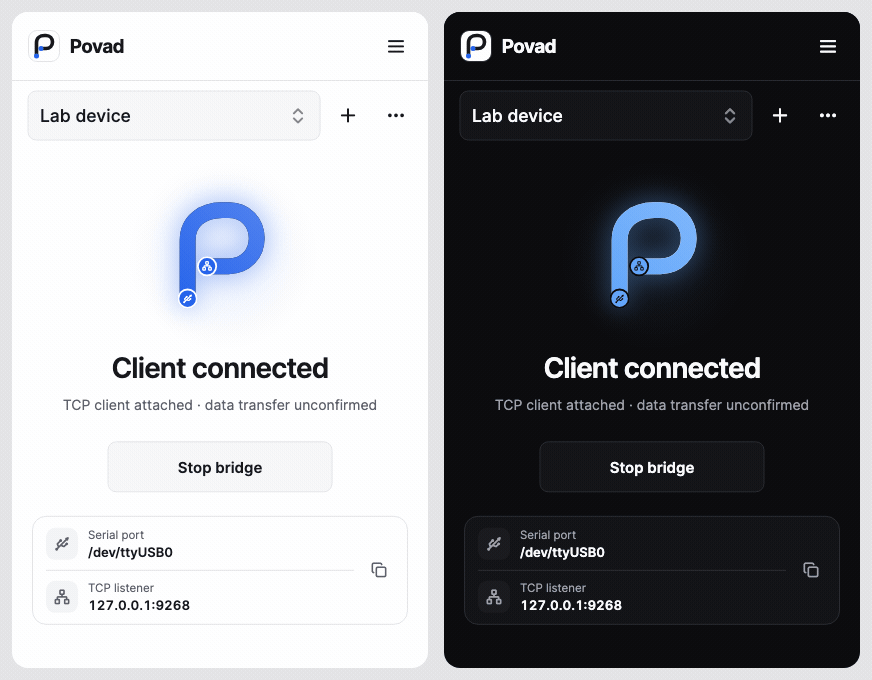

  

<h1 align="center">Povad</h1>

Your serial devices. Connected.

  
  
  

  <a href="https://github.com/ialexpovad/povad/releases/latest">Download</a> ·
  <a href="https://github.com/ialexpovad/povad/issues/new/choose">Feedback</a> ·
  <a href="CONTRIBUTING.md">Contribute</a>

**Povad connects serial devices to TCP clients**, on your computer or across
your local network. A small, focused interface with independent bridges,
clear connection states, and light and dark themes.

  
   Actual interface with sample connection data. <a href="assets/screenshots/overview.png">View static screenshot</a>.

## Built for everyday connections

- **Multiple bridges** — separate serial devices, settings, and TCP ports.
- **Easy LAN setup** — copy an address, scan a QR code, or discover a bridge with Bonjour.
- **Background operation** — desktop tray controls and an Android foreground notification.
- **Open at login** — enabled by default on supported desktops; change it in Settings.
- **Updates from GitHub** — verified downloads for Windows, Linux, and Android.
- **Your preferences** — English or Belarusian, light or dark, optional traffic animation.

## Get connected

1. Download and open Povad. Connect your serial device.
2. In **Bridge**, choose the device, baud rate, and parity. Select **Start bridge**.
3. Connect your TCP client to the displayed address. For another computer or
   phone, enable **Allow LAN clients** and use a listed LAN address.

Use **+** beside the bridge selector to add another connection. Each needs
its own serial device and TCP port. Enable **Wait for next client** to keep
that bridge listening after a client disconnects.

Povad forwards bytes unchanged and accepts one TCP client per bridge.
LAN access is off at each launch; enable it only on a trusted network and
optionally restrict client IPs. Opening Povad at login does not start bridges.

## Download

| Platform | Package | Installation |
| --- | --- | --- |
| Windows | x64 ZIP | Extract the entire folder, then open `povad.exe`. |
| Linux | x64 tar.xz | Extract the bundle, then run `povad`. |
| Android | arm64 APK | Install the APK; connect a USB–Serial adapter through USB-OTG. |
| macOS | Unsigned QA ZIP | Manual testing build; signing and notarization are pending. |

**[Get the latest release →](https://github.com/ialexpovad/povad/releases/latest)**

Keep desktop bundles in a permanent folder before enabling startup. macOS
autostart requires version 13 or later. Android needs compatible USB host
hardware; multiple adapters require a USB hub. Release assets include
`SHA256SUMS.txt`. Stop all bridges before installing an update.

## Help & contribute

[Report an issue](https://github.com/ialexpovad/povad/issues/new/choose) ·
[Development guide](CONTRIBUTING.md) · [Privacy](PRIVACY.md) ·
[Security](SECURITY.md) · [MIT License](LICENSE)
