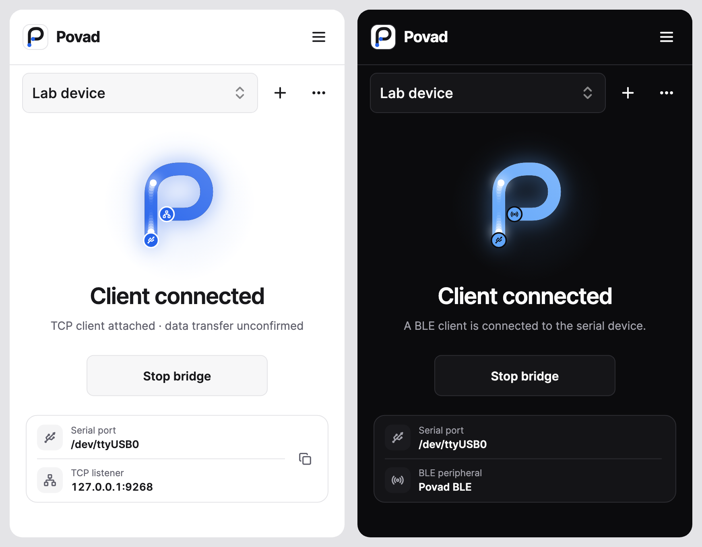

  

<h1 align="center">Povad</h1>

Your serial devices. Connected.

  
  
  

  <a href="https://github.com/ialexpovad/povad/releases/latest">Download</a> ·
  <a href="https://github.com/ialexpovad/povad/issues/new/choose">Feedback</a> ·
  <a href="CONTRIBUTING.md">Contribute</a>

**Povad connects serial devices to TCP and Bluetooth LE clients.** Forward
bytes unchanged through a local TCP listener, your trusted LAN, or a BLE
peripheral. Each bridge has its own settings and clear connection states.

  
   Actual interface with sample connection data.

## Built for everyday connections

- **Multiple bridges** — separate serial devices and transport settings.
- **Bluetooth LE bridge** — GATT write and notify characteristics with editable UUIDs; compatible with BT24-style clients.
- **Easy LAN setup for TCP** — copy an address, scan a QR code, or discover a bridge with Bonjour.
- **Background operation** — desktop tray controls and an Android foreground notification.
- **Open at login** — enabled by default on supported desktops; change it in Settings.
- **Updates from GitHub** — verified downloads for Windows, Linux, and Android.
- **Your preferences** — English or Belarusian, light or dark, optional traffic animation.

## Get connected

1. Download and open Povad. Connect your serial device.
2. In **Bridge**, choose the device, serial settings, and TCP or BLE transport. Select **Start bridge**.
3. For TCP, connect to the address on **Overview**. For another device, enable **Allow LAN clients** and use a listed LAN address. For BLE, find the advertising name in your BLE client, subscribe to notifications, and write to the configured characteristic.

Use **+** beside the bridge selector to add another connection. Each needs
its own serial device. TCP bridges also need distinct ports. Enable **Wait for
next client** on a TCP bridge to keep it listening after a disconnect.

Povad forwards bytes unchanged and accepts one active client per bridge.
One BLE bridge can run per Bluetooth adapter. **Require pairing** is on by
default. Turn it off only for clients that do not pair, such as BT24-compatible
software; any nearby Bluetooth device may then connect and send bytes to the
serial device. LAN access is off at each launch; enable it only on a trusted
network and optionally restrict client IPs. Opening Povad at login does not
start bridges.

BLE has been tested with serial hardware on macOS and Android. Linux BLE has
passed a container build and native tests but has no hardware verification.
Windows BLE has not yet been built or tested. Neither is qualified for release.
On Windows, BLE advertising uses the computer’s Bluetooth name; the app
cannot set a separate name.

## Download

| Platform | Package | Installation |
| --- | --- | --- |
| Windows | x64 ZIP | Extract the entire folder, then open `povad.exe`. |
| Linux | x64 tar.xz | Extract the bundle, then run `povad`. |
| Android | arm64 APK | Install the APK; connect a USB–Serial adapter through USB-OTG. |
| macOS | Unsigned QA ZIP | Manual testing build; signing and notarization are pending. |

**[Get the latest release →](https://github.com/ialexpovad/povad/releases/latest)**

Keep desktop bundles in a permanent folder before enabling startup. macOS
autostart requires version 13 or later. Android needs compatible USB host
hardware; multiple adapters require a USB hub. Release assets include
`SHA256SUMS.txt`. Stop all bridges before installing an update.

## Help & contribute

[Report an issue](https://github.com/ialexpovad/povad/issues/new/choose) ·
[Development guide](CONTRIBUTING.md) · [Privacy](PRIVACY.md) ·
[Security](SECURITY.md) · [MIT License](LICENSE)
