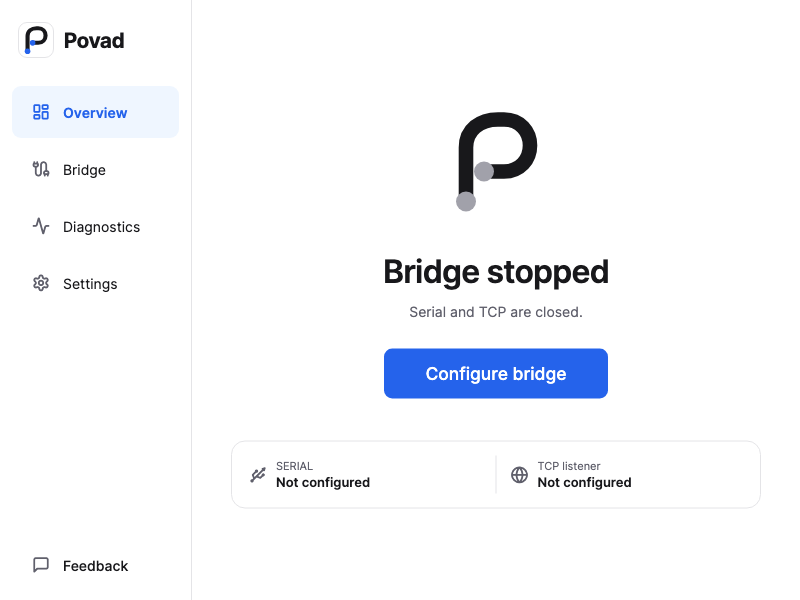

<p align="center"></p>

# Povad

**Device connectivity, starting with a transparent Serial ↔ TCP bridge.**

Povad is an open-source application in development for connecting devices and
network clients. Its first module relays bytes between a serial port and TCP
in both directions without changing the byte stream.

`Serial device ↔ Povad ↔ TCP client`

The platform is designed to grow with other transports, protocols, and virtual
ports as each capability is specified and tested.



## Current status

The desktop app now connects its overview and setup screen to an embedded
C++17 transport worker through typed Dart FFI. It accepts a local serial port,
baud rate, and loopback TCP port. One TCP client can connect per session;
disconnect ends that session. Status and errors come from the native worker.
The UI is available in English and Belarusian.

Native contract tests exercise bidirectional binary transfer with a
pseudo-terminal and loopback socket on desktop platforms. This is developer
functionality: physical serial adapters, instrument behavior, and the full
shutdown matrix still need hardware validation. Android includes USB Host
device selection and permission handling backed by the same native worker.
CI builds Android APKs with arm64 and x86_64 libraries and checks the app,
USB channel, and JNI worker on an emulator. Physical USB-serial permission,
detach, and byte-transfer behavior has not been validated. There is no public
product release yet.

The mobile interface has one main connection action and a top-right menu for
Bridge, Details, Settings, and feedback. On desktop, closing the window during
an active session keeps the process available from the system tray or menu bar;
on Linux the active window minimizes so it remains reachable on desktops
without a tray extension. Explicit Quit stops the worker before exit. On
Android, a connected-device foreground service and persistent notification
keep the same Flutter engine and native worker alive after the Activity closes.
The service requires a USB serial device with permission and starts while the
app is visible. Operating-system force-stop and process termination still end
the connection.

GitHub-based update delivery is planned. Platform support will be published
after each implementation passes build, UI, and real hardware validation.

## Run a developer build

With Flutter installed, run:

```sh
flutter pub get
flutter run -d macos
```

Open **Bridge** to enter a local serial port, then use **Overview** to start
the listener. The default endpoint is `127.0.0.1`. The operator can explicitly
enable listening on all network interfaces. Bridge setup then lists the current
LAN IPv4 endpoints with copy controls. A separate TCP client can connect to
one of those addresses; Povad does not yet have a client mode. The TCP bridge
has no client authentication. The macOS build was checked with Flutter 3.47.1.
Run `flutter analyze` and `flutter test` before submitting a change. UI tests use
[Alchemist](https://pub.dev/packages/alchemist) to compare the overview with
committed reference images in English and Belarusian at desktop and narrow
screen sizes. A widget test checks the primary action's label alignment.
GitHub Actions runs formatting, analysis, widget, visual, and accessibility
checks on every push and pull request. It also runs a macOS app smoke test and
builds the app for macOS, Linux, Windows, and Android. A successful
build does not establish serial hardware support. After an intentional visual
change, inspect the generated images and update the references with
`flutter test --update-goldens`.

## Feedback

Use [GitHub Issues](https://github.com/ialexpovad/povad/issues/new/choose) for
feature requests and reproducible problems. Please follow the
[security policy](SECURITY.md) for suspected vulnerabilities.
The in-app **Send feedback** action opens the same issue chooser in a browser.
Povad does not attach logs, device data, or local paths automatically.

## License

Povad is available under the [MIT License](LICENSE).
